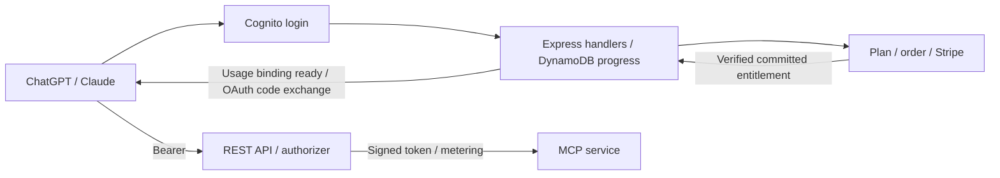

# Authentication and Subscription Specs

| Feature | Owns | Status |
|---|---|---|
| [001 — MCP service](../../tradingview-mcp/specs/001-add-lambda-deployment/spec.md) | Existing tools, finite Lambda transport/health, provider environment, ECR/publication/IAM | Legacy HTTP delivered locally; 42/55 tasks checked; REST/live follow-up pending |
| [002 — Access](002-authentication-api-access/spec.md) | Cognito, Node.js onboarding with durable state, OAuth tokens, REST API/authorizer and subscriber usage plans | Planned; 0/25 tasks checked |
| [003 — Billing](003-billing-subscriptions/spec.md) | Separate billing Lambda/DynamoDB, plan/order/Stripe, entitlements and durable decision history | Planned; 0/14 tasks checked |

Eligible subscribers skip purchase. Billing commits trusted entitlement; browser requests advance persisted onboarding; short endpoints complete code/token exchange. Clients send bearer credentials; the authorizer supplies the per-subscriber usage key from the validated signed token. Native quotas are best effort.

This project uses Node.js and Express on AWS Lambda for authentication and subscription billing and owns access infrastructure; see the [runtime plan](002-authentication-api-access/plan.md). The separate MCP service has no authentication/billing/workflow logic or related permissions. Its nine provider settings use native Lambda environment variables without a retrieval hook. Login and billing-management eligibility follow [access FR-003/FR-004](002-authentication-api-access/spec.md#functional-requirements).

REST uses a new named-stage endpoint; legacy HTTP commands/report v1 remain separate until secured cutover. Local-only testing does not establish live host/payment/gateway/recovery acceptance. The active feature in this project is 003; spec 002 remains the linked access workstream. The service project retains feature 001.

Read [client flow](002-authentication-api-access/contracts/client-onboarding.md), [workflow](002-authentication-api-access/contracts/onboarding-workflow.md), [REST gateway](002-authentication-api-access/contracts/rest-gateway.md), [service handoff](../../tradingview-mcp/specs/001-add-lambda-deployment/contracts/rest-migration.md) or [billing interface](003-billing-subscriptions/contracts/entitlements.md) for technical details. [History](../../tradingview-mcp/specs/scope-migration.md) records earlier decisions and validation.

The [background delivery contract](002-authentication-api-access/contracts/background-delivery.md) defines four Lambdas total: MCP, access (HTTP/on-demand provisioning), authorizer and billing; billing SQS/Pipe and replay schedule add no functions.

Data ownership has two domains and three physical tables: access owns AccessState; billing owns BillingState and BillingEntitlements. The entitlement projection separates eligibility reads from payment/customer data; verified updates commit atomically across billing tables.

[Future enhancements](future-work.md) tracks the deferred subscription/setup-confirmation email; it is not part of current implementation acceptance.

[Monitoring implementation and remaining runtime/live gates](../observability/README.md).
